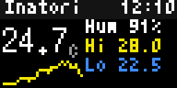
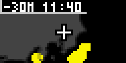
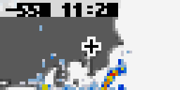
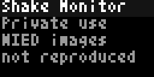
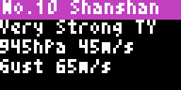
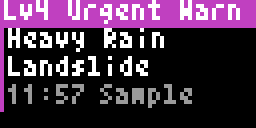

# Bousai — Japan weather and disaster information for Tronbyt

Seventeen English-language [Tronbyt Server](https://github.com/tronbyt/server) apps for 64×32 LED displays:
earthquakes, tsunami, volcanic alerts, typhoons, weather warnings, forecasts and animated maps.
Written in Pixlet/Starlark, using JMA and NIED data plus Wolfx and P2PQuake where needed.
**Bousai** (防災) means disaster prevention.

> **Not official warning equipment.** These apps do not receive push alerts. Display updates depend on the server's
> render schedule, app rotation, network and feed latency. They may be delayed or unavailable. Use official alerts,
> TV/radio and municipal guidance for safety decisions. Estimated intensity and wave-arrival times are approximate.

Bousai is an independent project, not affiliated with JMA, NIED, Gehirn Inc. or the
[NERV Disaster Prevention app](https://nerv.app/en/about.html). See the [feature comparison](docs/feature-coverage.md)
for what carries over to an LED display and what does not. No NERV artwork or branding is included.

## Quick start

You need a working Tronbyt Server, a 64×32 display and server-side internet access. No API keys are required.
The apps were rendered with **Pixlet v0.55.0**, as embedded in **Tronbyt Server v2.5.1**.
Most products cover Japan only; a location outside Japan produces a coverage message rather than a local forecast.

1. Download or clone this repository. The ready-to-use files are in **`apps/`**; no build step is needed.
2. Tronbyt → your device → **Add app → Upload app**. Choose `apps/bousai_forecast/bousai_forecast.star` to start.
3. Set **Location** to a place in Japan, save, and add the app to your rotation.
4. Add an alert app only after reading [Autopin and render intervals](docs/installation.md#alerts-autopin-and-render-intervals).
   Turn off **Show sample alert** before normal use.

You can also use Tronbyt's custom app repository setting or build individual ZIP uploads.
See [Installation](docs/installation.md) for both paths and troubleshooting.
Do not use the demo alerts as real warnings.

## Apps and examples

Click an app for its pages, settings, data sources, recommended setup and limitations.
Animations are 4× magnifications of 64×32 output. Captions identify illustrative sample alerts versus live-data captures;
live captures are snapshots from documentation generation, **not current conditions**. Shake uses an original illustration
rather than redistributing NIED imagery.

<!-- BEGIN GENERATED: apps -->
| App | Shows | Preview |
|---|---|---|
| [Bousai AMeDAS Observations](docs/apps/bousai_amedas.md)<br>`bousai_amedas` | Live JMA station observations |  |
| [Bousai EEW](docs/apps/bousai_eew.md)<br>`bousai_eew` | Earthquake early warning |  |
| [Bousai Weather Forecast](docs/apps/bousai_forecast.md)<br>`bousai_forecast` | JMA forecast and sun times |  |
| [Bousai Home](docs/apps/bousai_home.md)<br>`bousai_home` | Prioritised alerts and weather |  |
| [Bousai Lightning](docs/apps/bousai_lightning.md)<br>`bousai_lightning` | JMA thunder nowcast and strikes |  |
| [Bousai Quake](docs/apps/bousai_quake.md)<br>`bousai_quake` | Japan earthquake information |  |
| [Bousai Rain Radar](docs/apps/bousai_radar.md)<br>`bousai_radar` | JMA rain radar and outlook |  |
| [Bousai Risk Map](docs/apps/bousai_risk.md)<br>`bousai_risk` | JMA Kikikuru hazard risk map |  |
| [Bousai Shake Monitor](docs/apps/bousai_shake.md)<br>`bousai_shake` | Live shaking monitor |  |
| [Bousai Snow](docs/apps/bousai_snow.md)<br>`bousai_snow` | JMA snow depth and snowfall |  |
| [Bousai Timeline](docs/apps/bousai_timeline.md)<br>`bousai_timeline` | Last 72 hours of Japan alerts |  |
| [Bousai Tornado Watch](docs/apps/bousai_tornado.md)<br>`bousai_tornado` | JMA tornado probability nowcast |  |
| [Bousai Tsunami](docs/apps/bousai_tsunami.md)<br>`bousai_tsunami` | JMA tsunami warnings |  |
| [Bousai Typhoon Tracker](docs/apps/bousai_typhoon.md)<br>`bousai_typhoon` | JMA typhoon track and forecast |  |
| [Bousai Volcano Alerts](docs/apps/bousai_volcano.md)<br>`bousai_volcano` | JMA volcano levels and ash |  |
| [Bousai Warnings](docs/apps/bousai_warnings.md)<br>`bousai_warnings` | JMA weather warnings |  |
| [Bousai Weather Map](docs/apps/bousai_wxmap.md)<br>`bousai_wxmap` | JMA 5 km weather forecast map |  |
<!-- END GENERATED: apps -->

## Guides

- [Installation, Autopin and troubleshooting](docs/installation.md)
- [Example rotations and command-line renders](docs/examples.md)
- [Accessibility settings and illustrated comparisons](docs/accessibility.md)
- [NERV feature coverage and deliberate omissions](docs/feature-coverage.md)
- [Data sources, attribution, terms and privacy](docs/data-sources.md)
- [Development and library API](docs/development.md)
- [Runnable starter app](examples/bousai_hello/README.md)
- [Contributing](CONTRIBUTING.md) · [Changelog](CHANGELOG.md)
- [Maintainer release checklist](docs/releasing.md)

## Development quick start

Install Python 3.11+ and [Pixlet v0.55.0](https://github.com/tronbyt/pixlet/releases/tag/v0.55.0), then:

```sh
python3 tools/build.py --check                  # verify committed apps match src/
python3 tools/build.py --pixlet-check           # rebuild, render, lint and validate all apps
python3 tools/gen_docs.py                       # render examples and regenerate settings tables
python3 tools/build.py --examples --pixlet-check # build and exercise the starter app
```

Edit **`src/`**, not generated `apps/`. Commit both source and generated output.
Image and app checks access live external services; a successful render is not proof that every rare alert path works.
See [Development](docs/development.md) for dependencies, sample modes and known Pixlet constraints.

## License and data rights

Project software and original documentation are licensed under **[Apache-2.0](LICENSE)**.
[JMA attribution](https://www.jma.go.jp/jma/kishou/info/coment.html): 出典：気象庁ホームページ.
JMA data is processed, translated and reduced for the display; the result is not an official JMA product.
Natural Earth basemaps are public domain. See [NOTICE](NOTICE) and [Data sources](docs/data-sources.md).

**The software license does not relicense upstream data or images.** In particular, NIED Kyoshin Monitor content is
subject to [NIED's private-use / statutory-exception restrictions](https://www.kyoshin.bosai.go.jp/ja/about_kmoni/).
Do not publicly rebroadcast or redistribute its imagery without the necessary permission. Review provider terms and
applicable regulations before deploying a public or commercial earthquake-information service.
