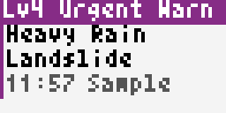
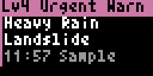
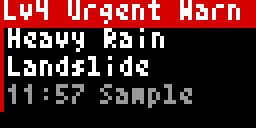
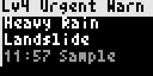
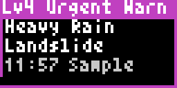
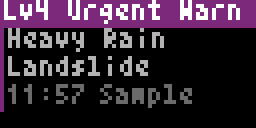
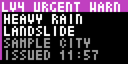
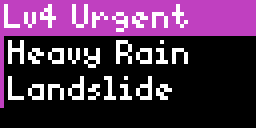
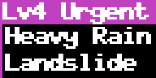

# Accessibility

[Back to README](../README.md) · [Example setups](examples.md)

All 17 apps expose the same five controls. These affect the app's own interface; externally supplied map images retain
their original pixels. The options are not a clinical guarantee of accessibility. Try the rendered result on your display.

| Setting | Key | Default | Values and effect |
|---|---|---|---|
| Theme | `theme` | `dark` | `dark`, `light`: background/text treatment |
| Colour vision | `palette` | `normal` | `normal`, `protan` (protanopia/deuteranopia), `tritan` (tritanopia), `mono` (monochromacy) |
| Contrast | `contrast` | `normal` | `low`, `normal`, `high`; low also disables app-controlled blinking |
| Text size | `text_size` | `standard` | `small`, `standard`, `large`, `xlarge`; larger text fits fewer lines |
| Text weight | `text_weight` | `normal` | `normal`, `bold`; bold expands glyphs by one pixel |

## Reading the display

- **Colour is not the only severity cue.** Labels such as `Lv4`, `Int 5+`, `Warning` and `Est.` identify the level or meaning.
- `Int` is JMA seismic intensity, not earthquake magnitude. `5-` / `5+` and `6-` / `6+` are the lower/upper subdivisions.
- `M` is earthquake magnitude; `Est.` marks an unofficial location estimate. A countdown is approximate, not a safety timer.
- `Lv2` through `Lv5` on weather-warning cards are JMA's warning levels. A volcano's numbered alert level is a different scale.
- Long text may scroll. Larger text produces more pages; some apps rotate pages over successive server renders.
- Information pages are designed to hold for at least 2.5 seconds within the default 15-second animation budget.
  Map timelines and EEW countdowns update more quickly; low contrast stops warning blinking, not all animation.
- No screen-reader output is supplied by the LED panel. Text descriptions here and the server's configuration UI are separate
  from the rendered image. The app UI is English; Pixlet's bundled fonts do not provide a Japanese-language interface.

## Maps

Radar, lightning, tornado, risk, snow, weather-distribution and Shake layers use provider-rendered raster images.
Bousai does not recolour those images. Theme, palette and contrast apply to its own labels, markers, keys and cards.
A text key cannot reproduce every spatial detail of a 64×32 map; consult the original provider for detailed interpretation.

NIED imagery is not reproduced in this guide. Shake's public preview is an original layout illustration; its live imagery
is subject to [NIED's terms](https://www.kyoshin.bosai.go.jp/ja/about_kmoni/).

## Examples

The same **illustrative** Warnings sample rendered with each setting. These are not active warnings. The animations
are generated by `tools/gen_docs.py`; look at their pagination as well as the colours.

<!-- BEGIN GENERATED: a11y -->
|  *Default: dark theme, normal colour vision, standard text* |  *Light theme* |
| :---: | :---: |
|  *Protanopia / deuteranopia palette* |  *Tritanopia palette* |
|  *Monochromacy palette* |  *High contrast* |
|  *Low contrast (also stops blinking)* |  *Small text (more lines per page)* |
|  *Large text* |  *Extra-large bold text* |
<!-- END GENERATED: a11y -->

## Practical choices

Start with standard text and normal contrast. Increase text size or weight for reading distance; reduce enabled pages
or lengthen **Display Time Seconds** if you need more time. If flashing is uncomfortable, use low contrast.
The device's brightness is a separate Tronbyt/device control, not the app's contrast setting.

When reporting a readability problem, include the app, theme, palette, contrast, size, weight, dwell time and a photo or
render. Do not infer accessibility from a palette name alone; the actual LED panel and viewing conditions matter.
