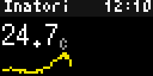

# Bousai AMeDAS Observations (`bousai_amedas`)

Bousai AMeDAS Observations covers NERV's real-time AMeDAS station view. It shows JMA observations from the nearest suitable station, or a station chosen by ID or name, in compact pages and optional trend charts.

<!-- BEGIN GENERATED: gallery -->
|  *Current JMA AMeDAS observations for the nearest station, including rain, wind and sunshine* |  *Twelve-hour temperature and rain trends for the Izu station* |
| :---: | :---: |
<!-- END GENERATED: gallery -->

## What it shows

At standard and small text sizes, the first page combines current temperature, a small temperature trend and selected overview values. Subsequent pages show rain, wind and gusts, snow, and station information, followed by temperature and/or rain trend charts when enabled. Large and extra-large text first show temperature, then one value per full-width row; the same selected trends follow. The station header includes its English name and the observation time in the configured timezone.

`10 min`, `1 hour` and `24 hours` are precipitation totals. Wind uses a 16-point compass direction; `G` means gust. Snow pages show depth and new one-hour snow only when positive. `Sun` is sunshine minutes in the last hour, and `Dist` and `Bearing` locate the selected station from the configured location. `Old` appears when the newest usable observation is more than 30 minutes old. Trend charts label their high and low bounds; an all-zero rain series says `No rain`.

There is no sample mode. A missing station override reports the unmatched text, a location with no qualifying station within 120 km asks for a Japanese location or station, and an unavailable station feed is reported on screen. Elements unavailable at a station are omitted.

## Recommended Tronbyt setup

Use the manifest's 10-minute Render Interval, leave Autopin off, and choose a Display Time of at least 15 seconds. The default Celsius, m/s and mm/cm units with a six-hour temperature trend are a compact general setup. Choose a station override when a particular JMA station matters more than the nearest station; use a 12-hour trend and **Both** trend charts when the longer rotation is acceptable.

<!-- BEGIN GENERATED: settings -->
## Settings

| Setting | Default | Choices | Description |
|---|---|---|---|
| **Location** (`location`) | — | Map picker | Your location. The nearest AMeDAS station that measures temperature and wind is used. |
| **Station (optional)** (`station`) | — | Free text | AMeDAS station ID (e.g. 44132) or English name (e.g. Sapporo). Overrides the nearest station. |
| **Temperature unit** (`temp_unit`) | Celsius (°C) | Celsius (°C) (`C`), Fahrenheit (°F) (`F`) | Celsius or Fahrenheit. |
| **Wind speed unit** (`wind_unit`) | m/s | m/s (`ms`), km/h (`kmh`), knots (`kt`), mph (`mph`) | Unit for wind speed and gusts. |
| **Rain and snow unit** (`precip_unit`) | mm / cm | mm / cm (`mm`), inches (`in`) | Millimetres / centimetres or inches. |
| **Humidity** (`el_humidity`) | On | On / Off | Show relative humidity. |
| **Precipitation** (`el_precip`) | On | On / Off | Show rain for the last 10 minutes, 1 hour and 24 hours. |
| **Wind and gusts** (`el_wind`) | On | On / Off | Show wind direction, speed and gusts. |
| **Snow** (`el_snow`) | On | On / Off | Show snow depth and snowfall when there is any. |
| **Sunshine** (`el_sun`) | On | On / Off | Show sunshine minutes in the last hour. |
| **Today's high and low** (`el_extremes`) | On | On / Off | Show the highest and lowest temperature so far today. |
| **Trend chart** (`trend`) | Temperature | Temperature (`temp`), Rain (`rain`), Both (`both`), None (`off`) | Chart of the recent observations. |
| **Trend length** (`trend_hours`) | 6 hours | 3 hours (`3`), 6 hours (`6`), 12 hours (`12`) | How many hours the trend chart covers. |

Plus the accessibility settings shared by every Bousai app — **Theme**, **Colour vision**, **Contrast**,
**Text size** and **Text weight**; see [Accessibility](../accessibility.md).

*This section is generated from the app's schema by `tools/gen_docs.py`.*
<!-- END GENERATED: settings -->

## How it works

The configured location is rounded locally to 0.001°. Unless **Station (optional)** is set, the app searches JMA's station table locally for the nearest station that measures temperature and wind, and rejects a nearest match beyond 120 km. A station override is matched locally against a station ID or English/Japanese name. The app requests the station table once per day, the AMeDAS latest-time marker for one minute, the newest three-hour observation block for two minutes, and earlier blocks needed for a 3/6/12-hour trend for one hour.

The station, text size and a one-day cache counter determine which consecutive pages are shown when all pages do not fit the display-duration budget. No third-party feed is used.

## Data sources

- Japan Meteorological Agency — AMeDAS station table, latest-time marker and 10-minute point observations — `https://www.jma.go.jp/bosai/amedas/const/amedastable.json`, `https://www.jma.go.jp/bosai/amedas/data/latest_time.txt`, and `https://www.jma.go.jp/bosai/amedas/data/point/<station>/<YYYYMMDD_HH>.json` — 出典：気象庁ホームページ; [terms of use](https://www.jma.go.jp/jma/kishou/info/coment.html).

## Limitations

- AMeDAS reports at station locations and on its publication cadence; it is not a measurement at the configured address.
- Station instruments differ, so a station can omit humidity, gust, snow or sunshine; quality-flagged observations are omitted.
- The nearest automatic choice requires both temperature and wind measurements and can be up to 120 km away.
- Trend charts use only the selected recent window. Renders occur in rotation, so the on-screen age can exceed the feed cache age.
- A 64×32 display cannot show a full station table or a detailed meteorological chart.
