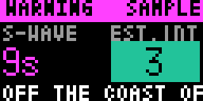

# Bousai EEW (`bousai_eew`)

Earthquake Early Warning for a 64×32 Tronbyt display. It covers the NERV-style EEW view: JMA Forecasts and Warnings, an unofficial estimate at the configured location, and a countdown to the estimated S-wave arrival.

<!-- BEGIN GENERATED: gallery -->
|  *Sample EEW warning modelled on the 2024 Noto Peninsula earthquake* |  *Sample EEW with large bold text in the light theme* |
| :---: | :---: |
<!-- END GENERATED: gallery -->

## What it shows

Active events appear one at a time, with up to three events cycling; Warnings come before Forecasts. The hero page shows the S-wave countdown and `Est. Int` at the configured location, then detail pages show the epicentre, magnitude (`M`), depth (`D`), JMA maximum intensity (`Max Int`), warned prefectures, report number, issue/origin time, and source. `Est.` means an unofficial local estimate, not JMA's forecast. `Int 5-`, `Int 5+`, `Int 6-`, and `Int 6+` are JMA seismic-intensity labels; levels are written as text as well as coloured. Warning headers blink unless Contrast is low.

A cancellation is shown briefly as `CANCELLED`; a PLUM/level report with an assumed epicentre has no magnitude or S-wave estimate. With no qualifying event, the app returns nothing unless Show when idle is on. The idle card reports either no active EEW, a source fallback, or unreachable feeds. Show sample alert displays an embedded 2024 Noto Peninsula M7.4 warning model with its countdown timed for the selected location.

## Recommended Tronbyt setup

Set Render Interval Minutes to **0**, Autopin to **On**, and Show when idle to **off**. This lets an active EEW take over the display and makes its render-time countdown as fresh as Tronbyt's scheduling permits. Choose Alerts to show according to the desired threshold: Warnings only for an alert-only display, or Int 3+ forecasts and warnings for earlier notices. Leave Estimate for my location on to show the local estimate and S-wave countdown.

<!-- BEGIN GENERATED: settings -->
## Settings

| Setting | Default | Choices | Description |
|---|---|---|---|
| **Location** (`location`) | — | Map picker | Your location in Japan. Matched to a JMA municipality on the server using JMA's own area polygons; coordinates are never sent anywhere. |
| **JMA area code (optional)** (`area_override`) | — | Free text | 7-digit JMA municipality code (e.g. 1310100). Overrides the location lookup. |
| **Alerts to show** (`min_level`) | All forecasts and warnings | All forecasts and warnings (`all`), Int 3+ forecasts and warnings (`int3`), Warnings only (`warn`) | Which EEW reports take over the display: everything JMA issues (forecasts start at Int 3 or M3.5), forecasts expecting Int 3 or more plus warnings, or warnings only (Int 5- or more). |
| **Estimate for my location** (`local_est`) | On | On / Off | Show Est. (an unofficial estimated intensity) and the S-wave arrival countdown for your location. Computed by this app from the JMA hypocentre with published attenuation and travel-time tables; JMA's area forecast is the official information. The countdown starts from the moment the server renders the app. |
| **Show when idle** (`show_idle`) | Off | On / Off | Show a calm status card (last check time and the latest EEW) when no EEW is active. Off: the app hides itself until an EEW arrives, so enable Tronbyt AutoPin. |
| **Show sample alert** (`demo`) | Off | On / Off | Show an embedded sample modelled on the 2024-01-01 Noto Peninsula earthquake warning (M7.4 report), timed so the S-wave countdown for your location is meaningful. |

Plus the accessibility settings shared by every Bousai app — **Theme**, **Colour vision**, **Contrast**,
**Text size** and **Text weight**; see [Accessibility](../accessibility.md).

*This section is generated from the app's schema by `tools/gen_docs.py`.*
<!-- END GENERATED: settings -->

## How it works

The primary feed is Wolfx's relay of the latest raw JMA EEW telegram, cached for 1 second. When it yields no usable report, the app falls back to NIED Kyoshin Monitor's current EEW JSON (latest timestamp and report, each cached for 1 second), then P2PQuake code 556 warnings (2 seconds). Wolfx and NIED calls are guarded with a 120-second cooldown after a stalled render; P2PQuake uses 300 seconds. Events remain active for 180 seconds after the latest report, 90 seconds for final reports, and 60 seconds for cancellations; a cache preserves overlapping events that a latest-only feed would otherwise displace.

The configured coordinates are rounded locally and used to calculate distance. JMA area polygons are used only to resolve the municipality/prefecture for warned-prefecture text. For a located, non-assumed hypocentre within 2,000 km, the app estimates PGV with Si & Midorikawa (1999), applies a nationwide-average site amplification, and converts PGV to JMA instrumental intensity with Midorikawa, Fujimoto & Muramatsu (1999). It interpolates JMA2001 S-wave travel times, then counts down from the server's render time to origin time plus that travel time. The countdown is therefore not a continuously running client-side timer.

## Data sources

- Wolfx — relayed JMA EEW telegram — `https://api.wolfx.jp/jma_eew.json` — JMA data via Wolfx.
- NIED Kyoshin Monitor — current EEW JSON — `http://www.kmoni.bosai.go.jp/webservice/{server, hypo/eew}/...` — NIED Kyoshin Monitor.
- P2PQuake — EEW warning history — `https://api.p2pquake.net/v2/history?codes=556&limit=30` — P2PQuake.
- Japan Meteorological Agency — municipality polygons and area dictionary — `https://www.jma.go.jp/bosai/common/const/{area.json,class20relm.json,geojson/class20s/...}` — 出典：気象庁ホームページ.

## Limitations

- This is not official warning equipment; Tronbyt renders only when the app reaches its rotation slot.
- `Est.` is a point-source, average-site calculation. It can underestimate shaking near a great-earthquake rupture and cannot represent local ground conditions; JMA area forecasts are authoritative.
- The S-wave time is an estimate from the reported hypocentre and starts from server render time. It may already read `Arrived` when rendered.
- Assumed/PLUM reports, cancellations, incomplete reports, locations outside the supported calculation range, and unavailable feeds cannot supply every field.
- The small display truncates or pages long names; live paths depend on third-party relay availability.