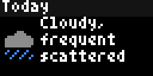
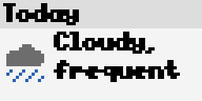

# Bousai Weather Forecast (`bousai_forecast`)

Bousai Weather Forecast covers the NERV-style JMA forecast view with JMA weather, temperatures, rain chance and official English text. It is a rotating set of compact forecast pages for a Japanese location.

<!-- BEGIN GENERATED: gallery -->
|  *JMA forecast with rain chance, 3-hourly outlook, weekly forecast and sunrise/sunset for Izu* |  *Large bold Fahrenheit forecast in the light theme* |
| :---: | :---: |
<!-- END GENERATED: gallery -->

## What it shows

Pages appear in this order when enabled: Today, Tomorrow, rain chance by six-hour block, the next 18 hours in three-hour steps, the seven-day outlook, and sunrise/sunset. Optional pages add plain, spoken-style forecast sentences and JMA's official English forecast text. Long weather descriptions can occupy a page before the temperature rows.

`Hi` and `Lo` are daily high and low temperatures. On Today, the signed value compares the forecast high or low with yesterday; on Tomorrow it compares with today. `obs` means the value is observed so far, not forecast. `Rain` is the probability for the current six-hour block; the optional table labels both days `Tdy` and `Tmr`. The three-hourly page includes wind direction and m/s where available; the weekly page writes high and low values as text. Temperatures can use °C or °F. Sunrise, sunset and day length use Japan Standard Time.

There is no sample mode. A location outside Japan or without a JMA area shows a setup message, unavailable feeds show a JMA-data message, and disabling every page shows an instruction to enable a page.

## Recommended Tronbyt setup

Use the manifest's 15-minute Render Interval and leave Autopin off. Choose a Display Time of at least 15 seconds so the rotating pages have room to appear. For a concise forecast, keep Today, Tomorrow, 3-hourly forecast, 7-day forecast and Sunrise and sunset enabled. Enable rain chance, Spoken-style summary or Official English forecast when those pages are useful enough to extend the rotation.

<!-- BEGIN GENERATED: settings -->
## Settings

| Setting | Default | Choices | Description |
|---|---|---|---|
| **Location** (`location`) | — | Map picker | Your location in Japan. Matched to a JMA municipality on the server using JMA's own area polygons; coordinates are never sent anywhere. |
| **JMA area code (optional)** (`area_override`) | — | Free text | 7-digit JMA municipality code (e.g. 1310100). Overrides the location lookup. |
| **Temperature unit** (`temp_unit`) | Celsius (°C) | Celsius (°C) (`C`), Fahrenheit (°F) (`F`) | Show temperatures in Celsius or Fahrenheit. |
| **Today** (`show_today`) | On | On / Off | Weather, high/low and rain chance for today. |
| **Tomorrow** (`show_tomorrow`) | On | On / Off | Weather, high/low and rain chance for tomorrow. |
| **Rain chance per 6 hours** (`show_rain`) | Off | On / Off | Chance of rain in each six-hour block. |
| **3-hourly forecast** (`show_hourly`) | On | On / Off | Weather and temperature every three hours for the next 18 hours. |
| **7-day forecast** (`show_week`) | On | On / Off | Weather, high and low for the coming week. |
| **Sunrise and sunset** (`show_sun`) | On | On / Off | Sunrise, sunset and day length. |
| **Spoken-style summary** (`show_summary`) | Off | On / Off | Plain sentences such as Forecast high of 26 (3 degrees lower than yesterday). |
| **Official English forecast** (`show_text`) | Off | On / Off | The JMA English forecast text for your area. |

Plus the accessibility settings shared by every Bousai app — **Theme**, **Colour vision**, **Contrast**,
**Text size** and **Text weight**; see [Accessibility](../accessibility.md).

*This section is generated from the app's schema by `tools/gen_docs.py`.*
<!-- END GENERATED: settings -->

## How it works

The location is rounded locally to 0.001° and resolved to JMA municipality, forecast-area and office codes. The app fetches the office forecast and regional three-hour forecast for 10 minutes, the official English VPFD51 forecast for 10 minutes, forecast mappings and English AMeDAS names for one day, the latest AMeDAS timestamp for one minute, and current AMeDAS observations for two minutes. Yesterday's AMeDAS temperature block caches for one day. Sunrise and sunset are calculated locally.

Pages are fitted to the display's duration budget. When the budget cannot fit every enabled page, a cache counter advances the contiguous page window on each render; its rotation state caches for one day. No third-party feed is used.

## Data sources

- Japan Meteorological Agency — area metadata, daily and weekly forecast, regional three-hour forecast, AMeDAS observations and official English VPFD51 text — `https://www.jma.go.jp/bosai/common/const/area.json`, `https://www.jma.go.jp/bosai/forecast/data/forecast/<office>.json`, `https://www.jma.go.jp/bosai/jmatile/data/wdist/VPFD/<class10>.json`, `https://www.jma.go.jp/bosai/amedas/data/`, and `https://www.data.jma.go.jp/multi/data/VPFD51/<office>_en.json` — 出典：気象庁ホームページ; [terms of use](https://www.jma.go.jp/jma/kishou/info/coment.html).

## Limitations

- It is a render-time display, not a continuously updating forecast or safety warning.
- Forecast points and AMeDAS temperature points are JMA-selected regional/station locations, not an address-level forecast.
- Some forecast values or official English text may be absent; observed highs/lows can replace unavailable same-day forecast values.
- The 64×32 display limits each page and can move long descriptions onto separate pages.
