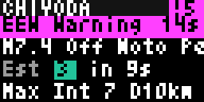
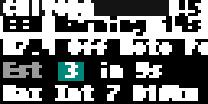

# Bousai Home (`bousai_home`)

A single prioritised panel for one location. It covers the NERV-style home screen by combining disaster information with weather and the last felt quake, then showing the most urgent cards first.

<!-- BEGIN GENERATED: gallery -->
|  *Sample Home cards ordered by alert priority* |  *Sample Home cards with the tritanopia palette and bold text* |
| :---: | :---: |
<!-- END GENERATED: gallery -->

## What it shows

The header shows the configured location and the count of active items at severity 2 or higher; otherwise it says `Calm`. Alert cards use textual labels such as `Lv2 Advisory`, `Lv3 Warning`, `Lv4 Urgent`, `Lv5 Emergency`, `Int 5+`, `EEW Warning`, and tsunami grades, so levels are never colour-only. Emergency bands blink unless Contrast is low. EEW cards can show `Est.` local intensity and an S-wave countdown; this estimate is unofficial. Weather cards show current AMeDAS temperature, today's forecast, rain chance, and sunrise/sunset when card time remains. A last-felt-quake card and `No warnings` complete calm states.

The display order is exact: highest severity first; then, within one severity, EEW; tsunami; urgent warnings (Lv4/Lv5, Lv3 landslide, and qualifying volcano/river/special information); eruption flash; record heavy rain or tornado watch; recent quake or shaking detection; ordinary warning; nearby typhoon; advisory; then calm information. Newer items win within the same class. Multiple warning elements at one level share a card. When there is not enough dwell time, the top card is kept, qualifying severity-4-or-higher cards are kept where possible, and remaining cards rotate across renders through a cache counter.

Only show alerts returns nothing unless the strongest item reaches Alert level; calm weather feeds are not read in that mode. The embedded sample combines the Noto EEW/timed advisory with Lv4 heavy rain plus landslide and a record-heavy-rain notice; it is not a live combined event. Outside a resolvable JMA area, a calm panel says so instead of weather cards.

## Recommended Tronbyt setup

Use Render Interval Minutes **1**, matching the manifest recommendation. For an always-visible overview, leave Only show alerts off and Autopin off. To use it as an alert app, turn Only show alerts on, select an Alert level (for example Warning/Lv3), turn Autopin on, and choose the sources and radii relevant to the location. The default recent-quake window is 1 hour, volcano radius 100 km, and typhoon radius 500 km.

<!-- BEGIN GENERATED: settings -->
## Settings

| Setting | Default | Choices | Description |
|---|---|---|---|
| **Location** (`location`) | — | Map picker | Your location in Japan. Matched to a JMA municipality on the server using JMA's own area polygons; coordinates are never sent anywhere. |
| **JMA area code (optional)** (`area_override`) | — | Free text | 7-digit JMA municipality code (e.g. 1310100). Overrides the location lookup. |
| **Earthquake early warning** (`src_eew`) | On | On / Off | Show active JMA EEW warnings and forecasts with the estimated intensity and S-wave countdown for your location. |
| **Shaking detection** (`src_shaking`) | On | On / Off | Show P2PQuake shaking detection, an unofficial evaluation of user reports and EEW detection. P2PQuake is a volunteer service that sometimes stalls, which fails that render; the app then skips it for a few minutes. Switch it off if your display shows render errors. |
| **Tsunami** (`src_tsunami`) | On | On / Off | Show tsunami warnings, advisories and forecasts. |
| **Weather warnings and notices** (`src_warnings`) | On | On / Off | Show JMA warnings and advisories (Lv2 to Lv5) for your municipality plus landslide, river flood, tornado watch and record heavy rain notices. |
| **Volcano** (`src_volcano`) | On | On / Off | Show volcanic alert levels (Lv2 and up) and eruption flash reports within the volcano radius. |
| **Recent earthquakes** (`src_quake`) | On | On / Off | Show earthquakes felt in the recent-quake window, and the last felt quake when calm. |
| **Special earthquake information** (`src_special`) | On | On / Off | Show the Nankai Trough earthquake extra information and the Hokkaido / Sanriku subsequent-earthquake advisory. |
| **Typhoons** (`src_typhoon`) | On | On / Off | Show typhoons whose centre is within the typhoon radius. |
| **Current conditions** (`src_amedas`) | On | On / Off | Show the temperature measured by the nearest AMeDAS station on the weather card. Weather cards only fill the dwell time the alerts leave. |
| **Today's forecast** (`src_forecast`) | On | On / Off | Show today's weather, high and low, chance of rain and sunrise / sunset on the weather card. Weather cards only fill the dwell time the alerts leave. |
| **Recent quake window** (`quake_hours`) | 1 hour | 1 hour (`1`), 3 hours (`3`), 6 hours (`6`), 12 hours (`12`), 24 hours (`24`) | How long an earthquake stays in the panel as an alert: felt at Int 3 or more at your location, or Int 5- or more anywhere in Japan. Weaker ones only appear as the last felt quake. |
| **Volcano radius** (`volcano_km`) | 100 km | 30 km (`30`), 50 km (`50`), 100 km (`100`), 200 km (`200`), 500 km (`500`) | Volcanoes and eruption reports farther away than this are ignored. |
| **Typhoon radius** (`typhoon_km`) | 500 km | 300 km (`300`), 500 km (`500`), 1000 km (`1000`), 2000 km (`2000`) | Typhoons whose centre is farther away than this are ignored. |
| **Only show alerts** (`alert_only`) | Off | On / Off | Show nothing (the app is skipped) unless an item reaches the alert level below. Turn on Tronbyt AutoPin so an alert takes over the display; the weather feeds are not read in this mode. A long-standing alert, such as a volcano held at Lv3 for years, keeps the panel up: raise the level or switch that source off. |
| **Alert level** (`alert_level`) | Warning (Lv3) | Advisory (Lv2) (`2`), Warning (Lv3) (`3`), Urgent warning (Lv4) (`4`), Emergency warning (Lv5) (`5`) | Lowest severity that counts as an alert when Only show alerts is on. Advisory: Lv2, EEW forecast of Int 3+, tsunami advisory. Warning: Lv3, tornado watch, tsunami warning, typhoon in range. Urgent: Lv4, record heavy rain, fresh eruption. Emergency: Lv5, EEW warning, major tsunami warning. |
| **Show sample alert** (`demo`) | Off | On / Off | Show an embedded sample: an early warning (2024-01-01 Noto Peninsula report), a tsunami advisory and a Lv4 heavy rain and landslide warning, ordered by priority. |

Plus the accessibility settings shared by every Bousai app — **Theme**, **Colour vision**, **Contrast**,
**Text size** and **Text weight**; see [Accessibility](../accessibility.md).

*This section is generated from the app's schema by `tools/gen_docs.py`.*
<!-- END GENERATED: settings -->

## How it works

Home first gathers enabled EEW, shaking, tsunami, municipality warnings/notices, volcano/eruption, recent quake, Nankai/Hokkaido-Sanriku, and nearby typhoon records, assigns each a severity/class/time tuple, and sorts it as above. Individual feeds retain their library caches: EEW data is 1–2 seconds; JMA tsunami list/clear status 30 seconds; JMA warnings 60 seconds; volcano warning 60 seconds and eruption list 30 seconds; earthquake list 30 seconds; special information 120 seconds; and typhoon targets 5 minutes. Stalled Wolfx, NIED, and P2PQuake requests use the core cooldown guard rather than repeatedly killing renders.

When cards leave dwell time, Home reads only the enabled calm sources: nearest AMeDAS current observations (latest stamp 60 seconds, current point 120 seconds) and today's JMA forecast (10 minutes). Location is resolved locally against JMA municipality polygons, or with the JMA area-code override. Coordinates are used for matching, distances, map-free local calculations, and source filters; JMA area-code requests do not send coordinates.

## Data sources

- Japan Meteorological Agency — areas, EEW-derived JMA data, tsunami, warnings/notices, volcano, earthquake, Nankai/Hokkaido-Sanriku, typhoon, AMeDAS, and forecast products — `https://www.jma.go.jp/bosai/{common/const,tsunami,warning,volcano,quake,typhoon,amedas,forecast}/...` and `https://www.data.jma.go.jp/multi/data/...` — 出典：気象庁ホームページ.
- Wolfx — relayed JMA EEW — `https://api.wolfx.jp/jma_eew.json` — JMA data via Wolfx.
- NIED Kyoshin Monitor — fallback EEW data — `http://www.kmoni.bosai.go.jp/webservice/...` — NIED Kyoshin Monitor.
- P2PQuake — EEW fallback and user-reported shaking evaluation — `https://api.p2pquake.net/v2/history?...` — P2PQuake.

## Limitations

- This is not official warning equipment; rotation, render time, source latency, and third-party outages delay or omit cards.
- EEW local intensity and S-wave arrival are unofficial estimates; shaking detection is an unconfirmed P2PQuake user-report evaluation.
- The priority order intentionally suppresses lower-priority cards when time is short. Disabled sources and radius/window filters also remove items.
- Outside Japan or without a resolved JMA municipality, municipality-specific warnings, local quake intensity, and forecast-dependent calm content can be unavailable.
- The sample is an embedded combination of historical-style alerts, not a record of one real simultaneous incident.