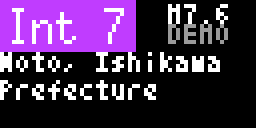

# Bousai Quake (`bousai_quake`)

Japan Meteorological Agency earthquake information for a 64×32 display. It covers seismic-intensity flash reports, epicentre and detailed reports, local shaking, JMA estimated-intensity maps, tsunami comments, and special earthquake information reflected in the NERV feature set.

<!-- BEGIN GENERATED: gallery -->
|  *Sample pages for the 2024 Noto Peninsula M7.6, Int 7 earthquake* |  *Sample quake in the monochrome palette with bold text* |
| :---: | :---: |
<!-- END GENERATED: gallery -->

## What it shows

The newest qualifying quake is shown first. Its pages start with an `Int` maximum-intensity band, magnitude, age, epicentre, origin time, report type, and the intensity in the configured municipality or prefecture. `Int 5-`, `Int 5+`, `Int 6-`, and `Int 6+` are JMA seismic-intensity labels and are always written as text. The app also shows the JMA tsunami comment, strongest reported places, and distance/bearing from the configured location when available.

A map page shows the epicentre cross and local marker. For strong quakes, it overlays JMA's estimated-intensity mesh when issued; otherwise it uses up to 90 observation points. Older configured quakes appear as compact rows. Nankai Trough Earthquake Extra Information and the Off the Coast of Hokkaido and Sanriku Subsequent Earthquake Advisory appear before quake pages when active. `Overseas` identifies an optional JMA distant-earthquake report. A recent epicentre-only report can appear as `Area: pending`; outside Japan, local intensity is unavailable.

Only recent quakes returns nothing when no qualifying quake is in the selected window and no special information is active. Otherwise an empty list becomes a no-quakes card, and an unavailable JMA list becomes a retry card. Show sample quake uses the embedded 2024 Noto Peninsula M7.6, Int 7 event.

## Recommended Tronbyt setup

Use Render Interval Minutes **5**, the manifest recommendation, for a normal recent-earthquake display. To use it as an alert app, select Only recent quakes (for example, 1–3 hours), turn Autopin on, and consider a 1-minute interval for faster rotation checks. Autopin should remain off when Always show is selected. Choose Minimum intensity to control ordinary report noise; Include overseas quakes is for JMA distant reports that may affect Japan's coasts.

<!-- BEGIN GENERATED: settings -->
## Settings

| Setting | Default | Choices | Description |
|---|---|---|---|
| **Location** (`location`) | — | Map picker | Your location in Japan. Matched to a JMA municipality on the server using JMA's own area polygons; coordinates are never sent anywhere. |
| **JMA area code (optional)** (`area_override`) | — | Free text | 7-digit JMA municipality code (e.g. 1310100). Overrides the location lookup. |
| **Minimum intensity** (`min_int`) | Int 1 and up (all felt quakes) | Int 1 and up (all felt quakes) (`1`), Int 2 and up (`2`), Int 3 and up (flash reports) (`3`), Int 4 and up (`4`), Int 5- and up (`5-`) | Hide earthquakes weaker than this JMA seismic intensity (shindo). |
| **Quakes to show** (`count`) | 3 | 1 (`1`), 2 (`2`), 3 (`3`), 4 (`4`), 5 (`5`) | How many recent earthquakes to cycle through. The newest gets full detail and a map; older ones get one summary row each. |
| **Only recent quakes** (`only_recent`) | Always show | Always show (`0`), Within 1 hour (`1`), Within 3 hours (`3`), Within 6 hours (`6`), Within 12 hours (`12`), Within 24 hours (`24`), Within 3 days (`72`) | Skip this app when the newest qualifying earthquake is older than this. Enable AutoPin in Tronbyt so a new quake takes over the display. |
| **Include overseas quakes** (`overseas`) | Off | On / Off | Add JMA distant earthquake reports (large quakes abroad that can affect Japan's coasts). |
| **Show sample quake** (`demo`) | Off | On / Off | Show the 2024-01-01 Noto Peninsula M7.6 (Int 7) earthquake as an embedded sample. |

Plus the accessibility settings shared by every Bousai app — **Theme**, **Colour vision**, **Contrast**,
**Text size** and **Text weight**; see [Accessibility](../accessibility.md).

*This section is generated from the app's schema by `tools/gen_docs.py`.*
<!-- END GENERATED: settings -->

## How it works

The JMA earthquake list is cached for 30 seconds. Flash, epicentre, detailed, and correction records sharing an event ID are merged; drills and cancellations are discarded. Per-event detail JSON is cached for one day. JMA's estimated-intensity list is cached for 5 minutes and its mesh PNGs for 7 days. The Nankai/Hokkaido-Sanriku multilingual reports are cached for 2 minutes, while JMA's current display-period configuration is cached for one day.

Location is resolved to a JMA municipality using JMA area polygons or the optional 7-digit area-code override. That code matches reported municipal intensity; designated-city wards are handled from their report-code range. The page planner limits the animation to six pages and shares render dwell time across pages.

## Data sources

- Japan Meteorological Agency — earthquake report list and detail JSON — `https://www.jma.go.jp/bosai/quake/data/{list.json,...}` — 出典：気象庁ホームページ.
- Japan Meteorological Agency — estimated seismic-intensity distribution list and mesh PNGs — `https://www.jma.go.jp/bosai/estimated_intensity_map/data/{list.json,...}` — 出典：気象庁ホームページ.
- Japan Meteorological Agency — Nankai Trough, Hokkaido/Sanriku, and display-period JSON — `https://www.data.jma.go.jp/multi/data/{VYSE50,VYSE60,other/temporary_info_config.json}` — 出典：気象庁ホームページ.
- Japan Meteorological Agency — municipality areas and polygons — `https://www.jma.go.jp/bosai/common/const/{area.json,class20relm.json,geojson/class20s/...}` — 出典：気象庁ホームページ.
- Natural Earth — embedded land outlines for the basemap — public domain.

## Limitations

- This is not official warning equipment; a report can appear only at the next Tronbyt rotation/render.
- Estimated-intensity meshes exist only for qualifying strong events. Observation dots are not a continuous intensity surface.
- The application shows JMA's latest available report; intensity, place names, tsunami comments, and maps can be pending or corrected.
- Local shaking requires a resolved Japanese municipality. The 64×32 map is simplified and long place names page or scroll.
- Sample-only embedded Noto mesh data represents that historical event; live map paths depend on JMA availability.