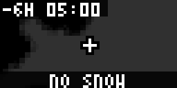

# Bousai Snow (`bousai_snow`)

Snow covers NERV's analysed snow depth and short-term snowfall map. It combines JMA 5 km snow tiles with nearby AMeDAS snow-gauge text.

<!-- BEGIN GENERATED: gallery -->
|  *Snow-depth map around Hokkaido at regional zoom with protanopia/deuteranopia label settings* |
| :---: |
<!-- END GENERATED: gallery -->

## What it shows

Choose analysed **Snow depth**, or snowfall totals for **3**, **6**, **12**, or **24 hours**. The map sequence selects analysis around -6 h, -3 h, and Now, then available forecasts at +2 h, +4 h, and +6 h. Each map has relative time and local clock labels. The **Snow gauges** page reports the latest AMeDAS time, highest value within 80 km, its place/distance, and the nearest reporting gauge; it explicitly says when no gauge reports snow.

The key labels classes in cm or cm per selected period. For snow depth it is `200+`, `150+`, `100+`, `50+`, `20+`, `5+`, and `<5`; snowfall keys use the selected period's JMA thresholds. Blank maps say **No snow** or **No snowfall**. The app does not hide when clear and has no sample mode; outside seasonal coverage it still supplies that blank-map state. It shows **Outside JMA snow coverage** or **No snow data from JMA now** when applicable. Zoom choices are City (~30 km), Prefecture (~90 km), Region (~250 km), and Wide (~500 km); Region is the default.

## Recommended Tronbyt setup

Use the manifest's 15-minute render interval, Autopin off, and a 15-second Display Time. Start with Snow depth and Region zoom for an overview; use a snowfall period and Prefecture zoom when short-term accumulation is the focus. Keep the colour key on when learning the JMA tile classes.

<!-- BEGIN GENERATED: settings -->
## Settings

| Setting | Default | Choices | Description |
|---|---|---|---|
| **Location** (`location`) | — | Map picker | Centre of the map. It chooses which map tiles are downloaded; coordinates are rounded locally to 0.001 degrees (about 100 m). Requested tiles reveal the selected map region. |
| **Layer** (`element`) | Snow depth | Snow depth (`snowd`), Snowfall, 3 hours (`snowf03h`), Snowfall, 6 hours (`snowf06h`), Snowfall, 12 hours (`snowf12h`), Snowfall, 24 hours (`snowf24h`) | Analysed snow depth, or the amount of snow that fell (analysis) or is forecast to fall in a 3, 6, 12 or 24 hour window. |
| **Map zoom** (`zoom`) | Region (~250 km) | City (~30 km) (`city`), Prefecture (~90 km) (`prefecture`), Region (~250 km) (`region`), Wide (~500 km) (`wide`) | How wide an area is shown around your location. |
| **Show my location** (`show_location`) | On | On / Off | Draw a marker at the centre of the map. |
| **Frame delay** (`delay`) | Normal | Fast (`300`), Normal (`500`), Slow (`900`) | How long each map frame stays on screen. |
| **Show colour key** (`legend`) | On | On / Off | End the loop with a text key that explains the JMA map colours. |

Plus the accessibility settings shared by every Bousai app — **Theme**, **Colour vision**, **Contrast**,
**Text size** and **Text weight**; see [Accessibility](../accessibility.md).

*This section is generated from the app's schema by `tools/gen_docs.py`.*
<!-- END GENERATED: settings -->

## How it works

The snow target-time index is cached for 300 seconds. The app separates analysis from forecast rows, selects the six-hour timeline positions when available, and caches each fresh-base tile for 180 seconds or an older tile for one hour. It picks a published tile zoom close to the view, displays an embedded land silhouette for wider views, adds the JMA mask and optional location cross, and treats JMA's transparent PNG tiles as blank.

The configured location is rounded locally and is used only for the map centre and AMeDAS distance calculations; this app has no municipality/area-code lookup. AMeDAS checks the current timestamp for 60 seconds, observations for 300 seconds, and station metadata for a day. Frames, gauge page, and key run in one loop, not a counter-driven page rotation. There are no third-party feeds or guarded fetches.

## Data sources

- Japan Meteorological Agency — analysed snow depth and snowfall forecast target times and tiles — `https://www.jma.go.jp/bosai/jmatile/data/snow/targetTimes.json` and `https://www.jma.go.jp/bosai/jmatile/data/snow/<basetime>/<member>/<validtime>/surf/<snowd|snowf03h|snowf06h|snowf12h|snowf24h>/{z}/{x}/{y}.png` — 出典：気象庁ホームページ.
- Japan Meteorological Agency — AMeDAS observations and station table — `https://www.jma.go.jp/bosai/amedas/data/latest_time.txt`, `.../data/map/<YYYYMMDDhhmmss>.json`, and `.../const/amedastable.json` — 出典：気象庁ホームページ.
- Japan Meteorological Agency — coastline/prefecture mask — `https://www.jma.go.jp/bosai/jmatile/data/map/none/none/none/surf/mask/{z}/{x}/{y}.png` — 出典：気象庁ホームページ.

## Limitations

- A blank map can mean no snow/snowfall pixels in the view; it is not a local pavement or road-condition report.
- JMA tile colours cannot be recoloured. Theme, colour-vision, contrast, text size, and text weight affect labels, key, marker, and status text; class bounds are written as text.
- Not every AMeDAS station has every snow sensor, and the nearest available gauge can be up to 80 km away.
- Rendering occurs in rotation; tile/gauge caching and the 64×32 screen limit timeliness and detail.
