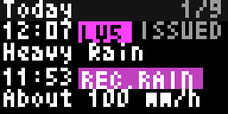
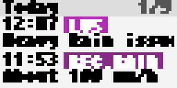

# Bousai Timeline (`bousai_timeline`)

Builds a newest-first record of recent warnings and disaster information for a 24-, 48- or 72-hour window. It covers the recent-alert timeline feature of the NERV Disaster Prevention app using JMA feeds and immutable JMA XML reports.

<!-- BEGIN GENERATED: gallery -->
|  *Sample timeline of a typhoon night modelled on Typhoon Hagibis (2019): warnings, notices, quake, EEW, tsunami, volcano and typhoon rows* |  *Light theme with bold text* |
| :---: | :---: |
<!-- END GENERATED: gallery -->

## What it shows

- Rows are grouped by local day as `Today`, `Yesterday` or a date. Each row has a time, text chip and description; levels and seismic intensity are always written as text, for example `Lv4`, `Int 5-`, `EEW 5-`, `Rec.Rain` and `V.Strong`.
- It can include municipality weather warnings and landslide alerts when issued, lowered or lifted; tornado watches, record short-term heavy rain and currently active designated-river flood notices; prefectural weather-information topics; felt earthquakes; optional EEW warnings/cancellations; tsunami reports/lifts; volcano level changes and eruptions; and typhoon formation, strengthening, weakening, end or latest status.
- **Minimum severity**, **Minimum quake intensity**, category toggles and **Minor advisories** limit the rows. The volcano radius restricts volcano activity near the configured location, except Lv4/Lv5 changes which always remain; repeated eruptions of a volcano are merged into one row per day.
- The newest page is always included. Older pages rotate across renders through a cache counter when they do not fit the configured display duration. When no event is available, the app shows `No events in the last <hours> h`; unavailable sources and an outside-Japan area appear as notes.
- **Show sample timeline** is a current-looking Typhoon Hagibis (2019) night with illustrative quake, EEW, tsunami and volcano rows. It is not a live history or a historical archive.

## Recommended Tronbyt setup

Set **Render Interval Minutes** to **5**, matching the manifest, and leave **Autopin** **off**: this is a recent-information log rather than an alert-only app. Use the default **Last 72 hours** for context, or 24 hours for a compact recent view. A **Display Time Seconds** value of 15 or more lets several day pages appear before the next render; long descriptions can need more time to scroll. Keep **EEW warnings** off unless desired, because it adds a P2PQuake request.

<!-- BEGIN GENERATED: settings -->
## Settings

| Setting | Default | Choices | Description |
|---|---|---|---|
| **Location** (`location`) | — | Map picker | Your location in Japan. Matched to a JMA municipality on the server using JMA's own area polygons; coordinates are never sent anywhere. |
| **JMA area code (optional)** (`area_override`) | — | Free text | 7-digit JMA municipality code (e.g. 1310100). Overrides the location lookup. |
| **Time window** (`window`) | Last 72 hours | Last 24 hours (`24`), Last 48 hours (`48`), Last 72 hours (`72`) | How far back the timeline reaches. |
| **Minimum severity** (`min_sev`) | Everything | Everything (`1`), Advisory and above (`2`), Warning and above (`3`), Urgent and above (`4`) | Hide events below this level. Advisory = Lv2, Int 3, tsunami advisory; Warning = Lv3, Int 4, tornado watch; Urgent = Lv4, Int 5-, record rain, EEW. |
| **Minimum quake intensity** (`quake_int`) | Int 2 and up | Int 1 and up (all felt quakes) (`1`), Int 2 and up (`2`), Int 3 and up (`3`), Int 4 and up (`4`), Int 5- and up (`5-`) | Hide earthquakes weaker than this JMA seismic intensity (shindo). |
| **Volcano radius** (`volcano_km`) | 300 km | 100 km (`100`), 300 km (`300`), 500 km (`500`), Anywhere in Japan (`0`) | Show eruptions and alert-level changes of volcanoes within this distance of your location. Level 4 and 5 changes always show. |
| **Weather warnings** (`show_warnings`) | On | On / Off | Advisories, warnings and landslide alerts for your municipality: when issued, lowered and lifted. |
| **Minor advisories** (`show_minor`) | On | On / Off | Include thunderstorm, dense fog, dry air, frost, low temperature, snow melting and icing advisories. Turn off to keep the timeline for rain, landslide, wind, wave, tide and snow. |
| **Tornado, record rain, floods** (`show_notices`) | On | On / Off | Tornado watch, record short-term heavy rain and designated river flood notices. |
| **Weather information** (`show_info`) | On | On / Off | JMA weather information bulletins for your prefecture, shown as their topics (for example Heavy rain, Lightning, Gusts). |
| **Earthquakes** (`show_quakes`) | On | On / Off | Felt earthquakes in Japan from the JMA list. |
| **EEW warnings** (`show_eew`) | Off | On / Off | Earthquake Early Warnings and cancellations from the P2PQuake history. Adds one request to P2PQuake. |
| **Tsunami** (`show_tsunami`) | On | On / Off | Tsunami warnings, advisories and forecasts. |
| **Volcanoes** (`show_volcano`) | On | On / Off | Eruptions (repeated eruptions of one volcano merge into one row a day) and alert-level changes. |
| **Typhoons** (`show_typhoon`) | On | On / Off | Formation, strengthening, weakening and the latest status of typhoons. |
| **Show sample timeline** (`demo`) | Off | On / Off | Show an embedded sample: a typhoon night modelled on Typhoon Hagibis (12 October 2019) with illustrative quake, EEW, tsunami and volcano rows. |

Plus the accessibility settings shared by every Bousai app — **Theme**, **Colour vision**, **Contrast**,
**Text size** and **Text weight**; see [Accessibility](../accessibility.md).

*This section is generated from the app's schema by `tools/gen_docs.py`.*
<!-- END GENERATED: settings -->

## How it works

For location-specific warnings, notices and prefectural information, the app resolves the rounded configured location to a JMA class20 municipality through JMA area polygons; the optional 7-digit override selects a municipality. It reads the seven-day JMA `extra_l.xml` and `eqvol_l.xml` Atom feeds, then fetches the immutable linked XML reports needed for warning, notice, typhoon and volcano details. Feed documents use a 120-second HTTP TTL; parsed immutable-report summaries are cached for five days. A render fetches at most 12 uncached reports and stops fresh fetches after 550 ms, newest first, so history fills in over subsequent renders. JMA earthquake, tsunami and flood lists use 30-, 60- and 60-second TTLs respectively; the optional P2PQuake EEW history uses a guarded 120-second request with a 300-second cooldown after a stalled attempt. The older-page position is cached for six hours.

## Data sources

- Japan Meteorological Agency — seven-day weather/disaster Atom feed and immutable linked XML reports — `https://www.data.jma.go.jp/developer/xml/feed/extra_l.xml` — 出典：気象庁ホームページ.
- Japan Meteorological Agency — seven-day earthquake/volcano Atom feed and immutable linked XML reports — `https://www.data.jma.go.jp/developer/xml/feed/eqvol_l.xml` — 出典：気象庁ホームページ.
- Japan Meteorological Agency — earthquake and tsunami lists — `https://www.jma.go.jp/bosai/quake/data/list.json` and `https://www.jma.go.jp/bosai/tsunami/data/list.json` — 出典：気象庁ホームページ.
- Japan Meteorological Agency — current designated-river flood forecasts and volcano-name lookup — `https://www.jma.go.jp/bosai/flood/data/r8/flood_xml.json` and `https://www.jma.go.jp/bosai/volcano/const/volcano_list.json` — 出典：気象庁ホームページ.
- P2PQuake — optional EEW history, code 556 — `https://api.p2pquake.net/v2/history?codes=556&limit=30` — used only when **EEW warnings** is enabled.

## Limitations

- The Atom feeds retain roughly seven days, but this app only offers 24/48/72-hour windows; initial renders can be incomplete while immutable reports enter the cache.
- Designated-river flood data is current only, not a historical timeline; river names are counted rather than translated.
- Typhoon rows reflect bulletin category changes, not a location-specific impact forecast. Weather-information rows are extracted topics, not full bulletin text.
- Optional P2PQuake EEW history is third-party and may be unavailable; guarded requests can be skipped during cooldown after a stall.
- This is a render-time display, not a real-time notification system. Feed latency, render interval and a 64×32 screen limit timeliness and detail.
