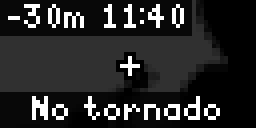

# Bousai Tornado Watch (`bousai_tornado`)

Tornado Watch covers NERV's JMA Tornado Nowcast map. It presents JMA's 10 km probability grid around the configured location together with the published level hit-rate wording.

<!-- BEGIN GENERATED: gallery -->
|  *Tornado nowcast at regional zoom with monochrome label settings* |
| :---: |
<!-- END GENERATED: gallery -->

## What it shows

The map runs the last 30 minutes of analysis (-30, -20, -10), **Now**, and forecasts at +10 through +60 minutes. Every map carries relative time and local clock labels. The **Tornado** status page says whether risk is now in the region, first expected later frame, was earlier, or is absent for the next hour.

The optional key spells out JMA's two levels: `1 1-7% hit` and `2 7-14% hit`. An empty map says **No tornado**. **Only when active** returns no output only when all selected map tiles are blank; otherwise the app remains in rotation. There is no sample mode. The app displays **Outside JMA nowcast coverage** or **No tornado data from JMA now** when it cannot form the map. Zoom choices are City (~30 km), Prefecture (~90 km), Region (~250 km), and Wide (~500 km).

## Recommended Tronbyt setup

Use the manifest's 5-minute render interval. For an alert card, enable **Only when active**, enable Autopin, and choose a 15-second Display Time. With that setting the active grid can take over the display and clears on a later blank render. Leave both alert settings off to keep the clear-state status in normal rotation. Prefecture zoom is the default; Region or Wide better shows approaching risk.

<!-- BEGIN GENERATED: settings -->
## Settings

| Setting | Default | Choices | Description |
|---|---|---|---|
| **Location** (`location`) | — | Map picker | Centre of the map. It chooses which map tiles are downloaded; coordinates are rounded locally to 0.001 degrees (about 100 m). Requested tiles reveal the selected map region. |
| **Only when active** (`only_when_active`) | Off | On / Off | Hide this app (so Tronbyt skips it) while the tornado nowcast map around you is empty. Use AutoPin to bring it forward when a risk appears. |
| **Map zoom** (`zoom`) | Prefecture (~90 km) | City (~30 km) (`city`), Prefecture (~90 km) (`prefecture`), Region (~250 km) (`region`), Wide (~500 km) (`wide`) | How wide an area is shown around your location. |
| **Show my location** (`show_location`) | On | On / Off | Draw a marker at the centre of the map. |
| **Frame delay** (`delay`) | Normal | Fast (`300`), Normal (`500`), Slow (`900`) | How long each map frame stays on screen. |
| **Show colour key** (`legend`) | On | On / Off | End the loop with a text key that explains the JMA map colours. |

Plus the accessibility settings shared by every Bousai app — **Theme**, **Colour vision**, **Contrast**,
**Text size** and **Text weight**; see [Accessibility](../accessibility.md).

*This section is generated from the app's schema by `tools/gen_docs.py`.*
<!-- END GENERATED: settings -->

## How it works

The app caches JMA's N3 target-time index for 60 seconds, uses the newest analysis as Now, then selects nearby 10-minute frames from -30 through +60 minutes. Fresh-base tiles cache for 180 seconds and older tiles for one hour. The shared tile renderer chooses a published zoom close to the view while requesting no more than three tiles, adds the JMA mask and optional centre marker, and identifies transparent JMA tiles as blank.

The configured location is rounded locally and only selects the tile view; this app has no municipality/area-code lookup. There is no render-to-render page counter: maps, status, and key run as one sequence and the duration budget drops oldest frames first if needed. The app uses only JMA data and no guarded third-party fetch.

## Data sources

- Japan Meteorological Agency — Tornado Nowcast target times and 10 km probability tiles — `https://www.jma.go.jp/bosai/jmatile/data/nowc/targetTimes_N3.json` and `https://www.jma.go.jp/bosai/jmatile/data/nowc/<basetime>/<member>/<validtime>/surf/trns/{z}/{x}/{y}.png` — 出典：気象庁ホームページ.
- Japan Meteorological Agency — coastline/prefecture mask — `https://www.jma.go.jp/bosai/jmatile/data/map/none/none/none/surf/mask/{z}/{x}/{y}.png` — 出典：気象庁ホームページ.

## Limitations

- The JMA grid is a regional probability product, not a tornado detection or a warning for a specific address.
- JMA map colours cannot be recoloured. Theme, colour-vision, contrast, text size, and text weight affect labels, key, marker, and status text; both levels are always written as text.
- **Only when active** considers tiles overlapping the current view. Failed requests are not treated as a clear map.
- Renders occur in rotation and are subject to feed/cache latency; a 64×32 screen cannot convey fine grid boundaries.
