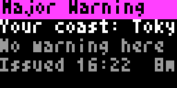

# Bousai Tsunami (`bousai_tsunami`)

Japan Meteorological Agency tsunami status for Tronbyt. It covers Major Tsunami Warnings, Warnings, Advisories, and Forecasts, with regional arrival/height information, a static coast map, and observation pages similar to the NERV tsunami feature.

<!-- BEGIN GENERATED: gallery -->
|  *Sample Major Tsunami Warning based on the 2024 Noto Peninsula event* |  *Sample tsunami status with large bold text in the light theme* |
| :---: | :---: |
<!-- END GENERATED: gallery -->

## What it shows

The first page names the highest grade in effect and the nearest forecast coast. It gives that coast's expected first-wave time or condition and expected height; when the location is farther than about 400 km from every JMA forecast coastline, it says `Location outside Japan` and shows the strongest region instead. `Major`, `Warn`, `Adv`, and `Fcst` are written grade labels: Major Tsunami Warning, Tsunami Warning, Tsunami Advisory, and Tsunami Forecast. A Forecast means slight sea-level change is expected, not damage.

A map page draws each warned coastline in its grade colour, marks causal epicentres and the location, and includes letter/count chips (`M`, `W`, `A`, `F`). Region pages prioritise the local coast, then severity and distance. When supplied by JMA, later pages show the strongest coastal and offshore gauge readings plus the nearest tide-gauge first-wave and high-tide times. `Arriving now`, `Imminent`, `May have arrived`, and `Arrived` are JMA first-wave conditions. The sample is based on the 2024 Noto Peninsula event; its two displayed gauge readings are illustrative sample values.

The app returns nothing when nothing meets Minimum level unless Show when idle is on. The idle card says no warning/advisory and may show the last JMA report; if the live feed is unavailable it either shows a retry card (idle enabled) or stays hidden.

## Recommended Tronbyt setup

Use Render Interval Minutes **1**, Autopin **On**, Show when idle **off**, and Forecast and up for the broadest alert coverage. Raise Minimum level to Advisory, Warning, or Major Tsunami Warning only when that is the intended threshold. With Autopin, a live qualifying tsunami status takes over the display and releases it when the app returns nothing.

<!-- BEGIN GENERATED: settings -->
## Settings

| Setting | Default | Choices | Description |
|---|---|---|---|
| **Location** (`location`) | — | Map picker | Your location in Japan. Matched to a JMA municipality on the server using JMA's own area polygons; coordinates are never sent anywhere. |
| **JMA area code (optional)** (`area_override`) | — | Free text | 7-digit JMA municipality code (e.g. 1310100). Overrides the location lookup. |
| **Minimum level** (`min_level`) | Forecast and up (all) | Forecast and up (all) (`1`), Advisory and up (`2`), Warning and up (`3`), Major Tsunami Warning only (`5`) | Skip tsunami information below this grade. Forecast means slight sea-level change expected, no damage. |
| **Show when idle** (`show_idle`) | Off | On / Off | Show a calm card with the last JMA report when nothing is in effect. Off: the app skips itself, so enable AutoPin in Tronbyt to let a warning take over the display. |
| **Show sample alert** (`demo`) | Off | On / Off | Show the 2024-01-01 Noto Peninsula Major Tsunami Warning (Ishikawa Noto, warnings along the Sea of Japan coast) as an embedded sample. |

Plus the accessibility settings shared by every Bousai app — **Theme**, **Colour vision**, **Contrast**,
**Text size** and **Text weight**; see [Accessibility](../accessibility.md).

*This section is generated from the app's schema by `tools/gen_docs.py`.*
<!-- END GENERATED: settings -->

## How it works

The JMA tsunami list and its clear-status JSON are cached for 30 seconds. The latest non-drill warning report is considered current only when it is newer than JMA's clear time; an Advisory or Warning also has a 96-hour maximum age, while a Forecast additionally expires at its `ValidDateTime`. Report detail, arrival/high-tide, coastal-observation, and offshore-observation JSON are cached for one day. JMA forecast-coast GeoJSON is cached for seven days.

The app computes straight-line distance from the configured coordinates to coastline vertices to choose the nearest JMA forecast region. It fetches no map tiles: the coast map is rendered from the JMA region geometry, with a static embedded basemap. At most six animation pages are retained, so the most relevant regions and observations take priority.

## Data sources

- Japan Meteorological Agency — tsunami report list, clear status, warning, arrival, and observation JSON — `https://www.jma.go.jp/bosai/tsunami/data/{list.json,clearweb.json,...}` — 出典：気象庁ホームページ.
- Japan Meteorological Agency — tsunami forecast-region coastline GeoJSON — `https://www.jma.go.jp/bosai/common/const/geojson/tsunami.json` — 出典：気象庁ホームページ.
- Natural Earth — embedded land outlines for the basemap — public domain.

## Limitations

- This is not official warning equipment; use official evacuation information and alerts for safety decisions.
- Arrival time, height, observation, and high-tide fields appear only when JMA supplies them. A forecast-coast distance is an approximation, not a local inundation or evacuation assessment.
- The sample's gauge readings are illustrative and are not JMA observations.
- The display updates at render time and can be delayed by rotation, feed latency, or JMA report corrections.
- The 64×32 map is static and simplified; a location outside the coastline threshold has no local-coast interpretation.