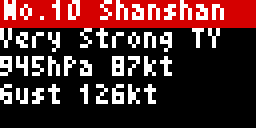

# Bousai Typhoon Tracker (`bousai_typhoon`)

Tracks active JMA tropical cyclones with their analysis and five-day forecast. It covers the typhoon analysis, track and forecast portion of the NERV Disaster Prevention app feature set.

<!-- BEGIN GENERATED: gallery -->
|  *Sample modelled on Typhoon No. 10 (Shanshan) of August 2024: identity card, details and the forecast track map* |  *Blue-yellow colour-vision palette, wind in knots, every JMA forecast time on the map* |
| :---: | :---: |
<!-- END GENERATED: gallery -->

## What it shows

- Each active system starts with a card for its number/name, category, central pressure, maximum sustained wind, gust, movement, position, distance and direction from the configured location, warning radii, closest forecast-centre approach and issue time. Wind can be shown in m/s, knots or km/h.
- The category is always text: `TD` is Tropical Depression, `TS` Tropical Storm, `STS` Severe Tropical Storm, and `TY` Typhoon. `Very Strong` and `Violent` are JMA intensity classes; `Extratropical Cyclone` is excluded from the active list.
- Map frames show the past track, current storm and gale circles when published, forecast-centre line, probability circle for each forecast step, and the configured location. Daily mode shows 24, 48, 72, 96 and 120-hour steps; the other mode uses every JMA forecast time. Up to four cyclones cycle nearest first.
- If no tropical cyclone is active, the app returns nothing by default. **Show when idle** instead shows `No active typhoon`; unavailable JMA data gets a similar message. **Show sample alert** is a current-looking illustration modelled on Typhoon No. 10 (Shanshan) in August 2024.

## Recommended Tronbyt setup

Set **Render Interval Minutes** to **10**, matching the manifest, and leave **Autopin** **off**: typhoons commonly remain active for days. Leave **Show when idle** off if the app should appear only during an active system; otherwise enable it for a calm card. Use a **Display Time Seconds** value of 15 or more for the identity card plus multiple map steps. Select the nearest one or two typhoons for a shorter rotation, or up to four for broad Pacific coverage.

<!-- BEGIN GENERATED: settings -->
## Settings

| Setting | Default | Choices | Description |
|---|---|---|---|
| **Location** (`location`) | — | Map picker | Your location in Japan. Matched to a JMA municipality on the server using JMA's own area polygons; coordinates are never sent anywhere. |
| **JMA area code (optional)** (`area_override`) | — | Free text | 7-digit JMA municipality code (e.g. 1310100). Overrides the location lookup. |
| **Show when idle** (`show_idle`) | Off | On / Off | Show a calm card while no typhoon is active. Off skips the app, so it only appears for a typhoon (use with Tronbyt AutoPin). |
| **Wind unit** (`wind_unit`) | Metres per second | Metres per second (`ms`), Knots (`kt`), Kilometres per hour (`kmh`) | Unit for maximum wind and gusts. |
| **Forecast steps** (`steps`) | Daily (24, 48, 72, 96, 120 h) | Daily (24, 48, 72, 96, 120 h) (`daily`), All JMA forecast times (`all`) | Which forecast times to animate on the track map. |
| **Typhoons shown** (`count`) | Nearest 3 | Nearest only (`1`), Nearest 2 (`2`), Nearest 3 (`3`), Nearest 4 (`4`) | How many active typhoons to cycle through, nearest to you first. |
| **Show sample alert** (`demo`) | Off | On / Off | Show a sample modelled on Typhoon No. 10 (Shanshan) of August 2024 near Kyushu instead of live data. |

Plus the accessibility settings shared by every Bousai app — **Theme**, **Colour vision**, **Contrast**,
**Text size** and **Text weight**; see [Accessibility](../accessibility.md).

*This section is generated from the app's schema by `tools/gen_docs.py`.*
<!-- END GENERATED: settings -->

## How it works

JMA's active-target list is cached for 5 minutes. For every active target, its analysis/specification document and forecast-track document are cached for 10 minutes. The configured coordinates are rounded to about 100 m and used locally for distance, bearing, closest approach and map framing; no JMA area code or map tile is requested. The available display-duration budget is shared among active systems, with the present frame and selected forecast steps retained first. There are no third-party feeds or persistent page counters.

## Data sources

- Japan Meteorological Agency — active tropical-cyclone targets — `https://www.jma.go.jp/bosai/typhoon/data/targetTc.json` — 出典：気象庁ホームページ.
- Japan Meteorological Agency — analysis/specifications — `https://www.jma.go.jp/bosai/typhoon/data/<TC>/specifications.json` — 出典：気象庁ホームページ.
- Japan Meteorological Agency — forecast tracks and gale areas — `https://www.jma.go.jp/bosai/typhoon/data/<TC>/forecast.json` — 出典：気象庁ホームページ.

## Limitations

- The probability circle is JMA's forecast-centre uncertainty area, not a wind-impact area; storm and gale circles are separate published radii.
- Closest approach is sampled along forecast-centre segments, so it is an approximation and does not estimate local wind, rain or storm surge.
- A 64×32 map cannot show all forecast labels, tracks and warning areas at once.
- The sample uses rounded illustrative positions, intensities and radii; it is not an archived JMA record. Live changes appear only after the next render and feed update.
