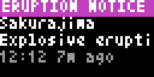
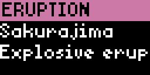

# Bousai Volcano Alerts (`bousai_volcano`)

Shows JMA volcanic alert levels, eruption flash reports and ashfall forecasts on a 64×32 Tronbyt display. It covers the volcanic-warning, eruption-flash and ashfall parts of the NERV Disaster Prevention app feature set.

<!-- BEGIN GENERATED: gallery -->
|  *Sample alert modelled on the July 2022 Sakurajima eruption: eruption notice, Lv3 card, level map, ranked list and ashfall forecast* |  *Red-green colour-vision palette, large text, volcanoes within 300 km of Kagoshima only* |
| :---: | :---: |
<!-- END GENERATED: gallery -->

## What it shows

- A recent eruption flash report is first: volcano name, eruption type, issue time and age. The alert band blinks unless low contrast is selected.
- The headline card shows the highest qualifying volcano, its level or keyword warning, distance and direction, effective time, and up to three affected municipalities. `Lv2` means do not approach the crater; `Lv3` means do not approach the volcano; `Lv4` means prepare to evacuate; `Lv5` means evacuate. Non-level volcanoes use text labels such as `Cau` or `Ext`.
- The map marks all listed volcanoes and makes qualifying ones larger; its legend gives a text level and count. A ranked list follows when more than one qualifies.
- When available, ashfall pages show JMA forecast polygons, ash or cinders, the crater, and the configured location. `May reach you` means the location is inside a forecast polygon. A scheduled forecast is conditional on an eruption; preliminary and detailed forecasts follow an eruption.
- With no qualifying alert, the normal view says so and shows the nearest volcano. If the nearest volcano is more than 1,500 km away, it says the location is outside Japan instead of showing a distance. With **Alert only**, no qualifying volcano or recent flash returns nothing, so the app is hidden. Unavailable volcano data produces a message unless Alert only is enabled.
- **Show sample alert** is a Sakurajima July 2022 model: Lv3, an explosive-eruption notice and a preliminary ashfall plume. It is not a live warning.

## Recommended Tronbyt setup

Set **Render Interval Minutes** to **5**, matching the manifest. For an alert-only display, turn on **Alert only**, choose the minimum level and either nationwide or a radius, then enable **Autopin**; without Alert only the app always renders and would remain pinned. Use a **Display Time Seconds** value of 15 or more to allow the flash, headline and map pages to cycle. Sakurajima has been Lv3 since 2022, so a nationwide Lv3 threshold will normally remain active.

<!-- BEGIN GENERATED: settings -->
## Settings

| Setting | Default | Choices | Description |
|---|---|---|---|
| **Location** (`location`) | — | Map picker | Your location in Japan. Matched to a JMA municipality on the server using JMA's own area polygons; coordinates are never sent anywhere. |
| **JMA area code (optional)** (`area_override`) | — | Free text | 7-digit JMA municipality code (e.g. 1310100). Overrides the location lookup. |
| **Scope** (`scope`) | Nationwide | Nationwide (`nationwide`), Near my location (`radius`) | Show volcanoes nationwide or only those within a radius of your location. |
| **Radius** (`radius`) | 300 km | 100 km (`100`), 200 km (`200`), 300 km (`300`), 500 km (`500`), 1000 km (`1000`) | Distance from your location used by 'Near my location'. |
| **Minimum level** (`min_level`) | Level 2 and above | Level 2 and above (`2`), Level 3 and above (`3`), Level 4 and above (`4`) | Lowest Volcanic Alert Level (or equivalent warning) to list. |
| **Eruption notice duration** (`flash_hours`) | 6 hours | 1 hour (`1`), 3 hours (`3`), 6 hours (`6`), 24 hours (`24`) | How long an eruption flash report stays on the display as an alert card. |
| **Ashfall forecast** (`show_ash`) | On | On / Off | Show the JMA ashfall forecast map for the most important volcano. |
| **Map page** (`show_map`) | On | On / Off | Show the Japan map with volcano markers coloured by level. |
| **Alert only** (`alert_only`) | Off | On / Off | Skip this app while nothing qualifies, so it only appears for an alert. Use with Tronbyt AutoPin. |
| **Show sample alert** (`demo`) | Off | On / Off | Show a sample modelled on the Sakurajima eruption of July 2022 instead of live data. |

Plus the accessibility settings shared by every Bousai app — **Theme**, **Colour vision**, **Contrast**,
**Text size** and **Text weight**; see [Accessibility](../accessibility.md).

*This section is generated from the app's schema by `tools/gen_docs.py`.*
<!-- END GENERATED: settings -->

## How it works

The current-warning list is cached for 60 seconds; eruption listing for 30 seconds and each eruption detail for 5 minutes; ashfall listing and forecast documents for 5 minutes. The configured coordinates are rounded to about 100 m, used only to calculate distance/direction and test ashfall polygons; this app does not request a location-specific warning feed. It chooses high-priority flash, ash, headline, map and list pages within the current display-duration budget rather than keeping a persistent page counter. There are no third-party feeds.

## Data sources

- Japan Meteorological Agency — volcano warnings and alert levels — `https://www.jma.go.jp/bosai/volcano/data/warning.json` — 出典：気象庁ホームページ.
- Japan Meteorological Agency — eruption flash reports — `https://www.jma.go.jp/bosai/volcano/data/eruption.json` and `https://www.jma.go.jp/bosai/volcano/data/eruption/<event>.json` — 出典：気象庁ホームページ.
- Japan Meteorological Agency — ashfall forecast index and documents — `https://www.jma.go.jp/bosai/volcano/data/ashfall/japan.json` and `https://www.jma.go.jp/bosai/volcano/data/ashfall/<volcano-code>.json` — 出典：気象庁ホームページ.
- Japan Meteorological Agency — official English municipalities under volcanic warnings — `https://www.data.jma.go.jp/multi/data/VFVO50/en.json` — 出典：気象庁ホームページ.

## Limitations

- Eruption-flash and ashfall parsing follow JMA page codes but were not tested against a live issue during development.
- Ashfall polygons are forecasts, not observations, and the display cannot express all timing, thickness or uncertainty on a 64×32 matrix.
- Alert level is not a prediction of a particular eruption. Render timing and feed latency delay display of a new report.
- The sample has illustrative surrounding volcanoes and ash plume; it is not an archived JMA record.
