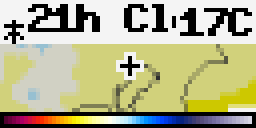

# Bousai Weather Map (`bousai_wxmap`)

Weather Map covers NERV's 5 km weather-distribution forecast. It animates JMA weather, temperature, three-hour rain, or three-hour snow forecasts around the configured location and supplements frames with regional forecast text.

<!-- BEGIN GENERATED: gallery -->
|  *Temperature forecast at regional zoom with light, extra-large bold labels* |
| :---: |
<!-- END GENERATED: gallery -->

## What it shows

Choose **Weather**, **Temperature**, **Rain, 3 hours**, or **Snow, 3 hours**. The app takes the current and later three-hourly target frames, up to 14 frames toward midnight of the next day. Weather and temperature labels show weekday/hour; rain and snow labels show the three-hour ending window. When available, the map banner writes the regional forecast weather (`Clear`, `Cloudy`, `Rain`, `Rain/snow`, or `Snow`) and temperature in C.

The **Forecast** page gives the JMA first-forecast-area name, its temperature point, and the nearest AMeDAS temperature within 40 km when available. The optional key explains the selected JMA tile classes: weather categories; temperature from `40+` to `<-25` C; rain from `1-5` to `20+` mm/3h; or snow from `1-3` to `6+` cm/3h. A blank map says **No data**. The app stays in rotation, has no sample mode, and reports **Outside JMA forecast grid** or **No forecast map from JMA now** instead of map frames when needed. Zoom choices are City (~30 km), Prefecture (~90 km), Region (~250 km), and Wide (~500 km); Region is the default.

## Recommended Tronbyt setup

Use the manifest's 15-minute render interval, Autopin off, and a 15-second Display Time. Weather is the default general-purpose layer; Temperature is useful for the concise text banner, while the rain/snow layers show each three-hour accumulation window. Region zoom gives the normal forecast context; use Prefecture zoom for local detail.

<!-- BEGIN GENERATED: settings -->
## Settings

| Setting | Default | Choices | Description |
|---|---|---|---|
| **Location** (`location`) | — | Map picker | Centre of the map. It chooses which map tiles are downloaded; coordinates are rounded locally to 0.001 degrees (about 100 m). Requested tiles reveal the selected map region. |
| **Layer** (`element`) | Weather | Weather (`wm`), Temperature (`temp`), Rain, 3 hours (`r3`), Snow, 3 hours (`s3`) | Weather, temperature, 3-hour rain or 3-hour snow forecast on JMA's 5 km grid. |
| **Map zoom** (`zoom`) | Region (~250 km) | City (~30 km) (`city`), Prefecture (~90 km) (`prefecture`), Region (~250 km) (`region`), Wide (~500 km) (`wide`) | How wide an area is shown around your location. |
| **Show my location** (`show_location`) | On | On / Off | Draw a marker at the centre of the map. |
| **Frame delay** (`delay`) | Normal | Fast (`300`), Normal (`500`), Slow (`900`) | How long each map frame stays on screen. |
| **Show colour key** (`legend`) | On | On / Off | End the loop with a text key that explains the JMA map colours. |

Plus the accessibility settings shared by every Bousai app — **Theme**, **Colour vision**, **Contrast**,
**Text size** and **Text weight**; see [Accessibility](../accessibility.md).

*This section is generated from the app's schema by `tools/gen_docs.py`.*
<!-- END GENERATED: settings -->

## How it works

The weather-distribution target-time index is cached for 600 seconds. The app keeps entries no older than 90 minutes, takes the first 14, and caches fresh-base tiles for 180 seconds and older tiles for one hour. The configured point is matched locally to a JMA first-forecast-area polygon cached for seven days. That area code fetches `wdist/VPFD/<code>.json`, cached for 900 seconds, for the banner weather/temperature text.

The location is rounded locally and used for tiles, the first-forecast-area polygon, and nearby AMeDAS lookup; it is not a municipality/area-code setting. AMeDAS current time caches for 60 seconds, observations for 300 seconds, and its station table for a day. Maps, status text, and key run as one duration-limited loop rather than a counter-driven rotation. All fetches are JMA; no guarded third-party request is used.

## Data sources

- Japan Meteorological Agency — weather-distribution forecast target times and 5 km tiles — `https://www.jma.go.jp/bosai/jmatile/data/wdist/targetTimes.json` and `https://www.jma.go.jp/bosai/jmatile/data/wdist/<basetime>/<member>/<validtime>/surf/<wm|temp|r3|s3>/{z}/{x}/{y}.png` — 出典：気象庁ホームページ.
- Japan Meteorological Agency — first forecast area polygons and regional three-hourly forecast — `https://www.jma.go.jp/bosai/jmatile/data/map/none/none/none/surf/click_first_area/data.geojson` and `https://www.jma.go.jp/bosai/jmatile/data/wdist/VPFD/<area-code>.json` — 出典：気象庁ホームページ.
- Japan Meteorological Agency — AMeDAS observations and station table — `https://www.jma.go.jp/bosai/amedas/data/latest_time.txt`, `.../data/map/<YYYYMMDDhhmmss>.json`, and `.../const/amedastable.json` — 出典：気象庁ホームページ.
- Japan Meteorological Agency — coastline/prefecture mask — `https://www.jma.go.jp/bosai/jmatile/data/map/none/none/none/surf/mask/{z}/{x}/{y}.png` — 出典：気象庁ホームページ.

## Limitations

- The map is a gridded JMA forecast, not a street-level forecast; banner text may be unavailable when the regional feed has no matching time or term.
- JMA tile colours cannot be recoloured. Theme, colour-vision, contrast, text size, and text weight affect labels, key, marker, and status text; all key classes are written as text.
- AMeDAS is an observation, not the forecast; the nearest station may lack a temperature report or be up to 40 km away.
- Rendering and cache timing add delay, and the 64×32 display limits map and key detail.
